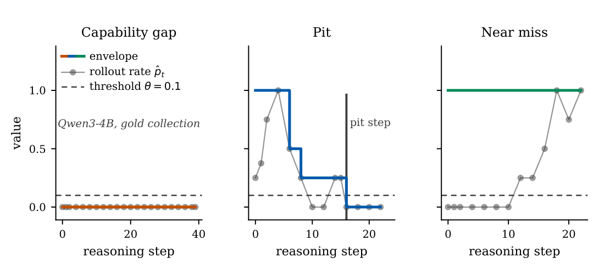
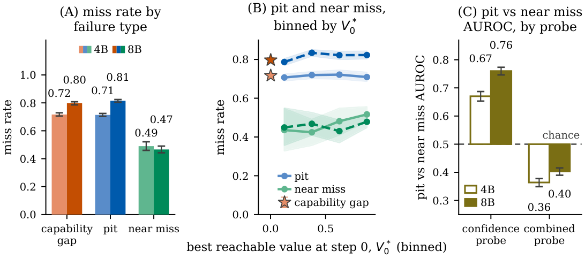

# Effectiveness of Hidden-State Probes for Localizing Reasoning Failures

**Interpretability as a Science: NeurIPS 2026 Workshop**

[](https://arxiv.org/abs/2610.22046)
[](https://openreview.net/forum?id=X1D0ZeEeZ4)
[](https://github.com/SSubhnil/Reasoning-Failures)
[](https://huggingface.co/datasets/ssubhnil/Reasoning-Failures)

Code for [Effectiveness of Hidden-State Probes for Localizing Reasoning Failures](https://openreview.net/forum?id=X1D0ZeEeZ4) (Interpretability as a Science: NeurIPS 2026 Workshop). The data are in the Hugging Face dataset [ssubhnil/Reasoning-Failures](https://huggingface.co/datasets/ssubhnil/Reasoning-Failures).

The code reproduces the paper's tables and figures for Qwen3-4B and Qwen3-8B from the released traces, Monte Carlo rollout labels and probe scores, and contains the probe training, rollout, evaluation and transcoder classifier pipelines.



Failure types on three Qwen3-4B traces from the gold collection. Each panel shows the rollout rate $\hat p_t$ at the evaluated steps and the envelope $V^*_t$. For a pit, the envelope crosses $\theta = 0.1$ partway through the trace, at the pit step. For a near miss, the envelope never crosses the threshold. For a capability gap, the envelope is below the threshold from step 0.



Confidence-probe predictions at the final step of each trace on the broad collection (read positions are described under Data), with training and validation split by problem. (A) Miss rate by failure type. (B) Pit and near miss, binned by the best reachable value at step 0. (C) Pit-versus-near-miss AUROC of the confidence probe and the combined probe.

## Models

| Model | Repository | Licence |
|---|---|---|
| Qwen3-4B | [Qwen/Qwen3-4B](https://huggingface.co/Qwen/Qwen3-4B) | Apache-2.0 |
| Qwen3-8B | [Qwen/Qwen3-8B](https://huggingface.co/Qwen/Qwen3-8B) | Apache-2.0 |
| Qwen3-4B transcoders | [mwhanna/qwen3-4b-transcoders](https://huggingface.co/mwhanna/qwen3-4b-transcoders) | MIT |
| Qwen3-8B transcoders | [mwhanna/qwen3-8b-transcoders](https://huggingface.co/mwhanna/qwen3-8b-transcoders) | MIT |

The transcoder classifier reads model layers 19 to 24, stored in the transcoder repositories as `layer_18.safetensors` to `layer_23.safetensors`. The download commands and the extraction steps are in [docs/reproduction.md](docs/reproduction.md#transcoder-failure-type-classifier).

## Install

vLLM 0.19.1 requires a different transformers version from the one the analyses pin, so two environments are used.

```sh
uv venv --python 3.11 .venv
uv pip install --python .venv/bin/python -e '.[test]'

uv venv --python 3.12 .venv-vllm
uv pip install --python .venv-vllm/bin/python -r requirements-vllm.txt
uv pip install --python .venv-vllm/bin/python --no-deps -e .
```

The rollout script and the evaluation server run in `.venv-vllm`. Every other command runs in `.venv`.

## Data

```sh
hf download ssubhnil/Reasoning-Failures --repo-type dataset --local-dir hf_data \
  --include "runs/*" --include "data/*" \
  --exclude "runs/hf_pull/mc_rollouts_locus_k16/*/campaign/branches.jsonl.zst" \
  --exclude "runs/hf_pull/mc_rollouts_locus_k16/*/corpus/*" \
  --exclude "*/conf_probe.pt" --exclude "*/value_probe.pt" \
  --exclude "runs/hf_pull/probe_corpus_16k/*" --exclude "runs/value_probe/ask_a_818/_packed/*"
ln -s hf_data/runs runs
ln -s hf_data/data data
```

This downloads the inputs of the table commands. Omit the `--include` and `--exclude` options to download everything, including the rollout continuations, the rollout corpus, the traces, the hidden-state features, the evaluation runs and the probe checkpoints.

Steps are made by splitting each trace at blank lines and merging adjacent blocks until every step has at least 400 tokens (`merged_step_char_spans` in `sst/shared/extractors.py`, Qwen3 tokenizer).

The hidden-state features (one vector per step: the model's hidden state at layers 23 and 24, read at the stored end position of each step, 5,120 numbers at Qwen3-4B and 8,192 at Qwen3-8B, in bfloat16) are in the dataset at `runs/hf_pull/probe_corpus_16k/qwen3-{4b,8b}/_p1_packed/` (34.0 GB and 52.7 GB). Download them with `--include "runs/hf_pull/probe_corpus_16k/qwen3-4b/_p1_packed/*"` to reuse them as is, or regenerate them with `scripts/precompute_p1_features.py` (see `docs/reproduction.md`).

Read positions. The features were not read exactly at the last token of each step. The stored step positions (`step_spans`) were computed from each step tokenized on its own, and the features were extracted in left-padded batches without shifting those positions. Each read therefore sits earlier in the trace than the step's last token, by the same number of tokens for every step of a trace: a median of 157 tokens at Qwen3-4B and 148 at Qwen3-8B, at most 512, and zero for about 22% of traces (pad widths reconstructed from the batching rule). For the final step, the read falls inside the intended step in 51.0% (4B) and 51.6% (8B) of traces and in an earlier step in 48.9% and 48.3% (the remaining 0.1% fall between steps). Tokenizing steps separately adds a smaller drift (a median of 3 tokens on a 40-trace Qwen3-4B sample). The probes in the paper were trained and evaluated on these features, and `scripts/precompute_p1_features.py` reads at the same positions. No result was re-scored with corrected positions. To read exact last-token states, locate steps with `merged_step_char_spans` and map their character spans to the token offsets of the joint prompt-and-trace tokenization.

## Reproduce

```sh
mkdir -p outputs/conceal
cp runs/conf_probe/conceal/steps_*.parquet outputs/conceal/
export SST_CONCEAL_SCORES=runs/conf_probe_psplit/blindspot_scores SST_CONCEAL_OUT=outputs/conceal

python -m scripts.aggregate_conf_probe --root runs/conf_probe_psplit --out outputs/detection.csv
python -m analysis.miss_rate_by_failure_class --loss bce
python -m analysis.paired_localization --pred-a runs/resp/bipp_locus_4b/score_lasttok_predictions.csv --vs-null \
  --labels runs/resp/bipp_locus_4b/gold_pits_by_md5.pt --val-problems runs/resp/bipp_locus_4b/val_problems.json \
  --n-boot 2000 --seed 0
```

The first command gives held-out detection AUROC across retraining seeds, the second the miss rate of each failure class, and the third the pointer probe against the length rule on the same 4B pit steps. These commands run on CPU.

[docs/reproduction.md](docs/reproduction.md) lists the command for every table and figure, the evaluation and rollout recipes, the transcoder extraction, fit and table steps, and the limitations.

## Rollouts with vLLM

`scripts.run_step_rollouts` builds one prefix per step of each requested trace (paragraphs are merged until a step reaches `--step-k` tokens) and samples `--k` continuations from each with vLLM in process, with prefix caching. On one L40S (48 GB), `--max-num-seqs 256 --prefix-batch 64` gave the highest throughput of the settings we timed: 1,406 generated tokens/s for Qwen3-4B and 833 for Qwen3-8B. The timed workload had 35 prefixes, so at `--prefix-batch 64` all of them went in one call. GPU utilization read about 100 % in every setting, so the settings are compared by tokens/s. [docs/throughput.md](docs/throughput.md) lists the settings, the measured table and the graphs.

## Citation

```bibtex
@inproceedings{subhnil2026effectiveness,
  title={Effectiveness of Hidden-State Probes for Localizing Reasoning Failures},
  author={Shubham Subhnil and Yannis Belkhiter and Erik Miehling and Adam Dahlgren Lindstr{\"o}m and Elizabeth M. Daly},
  booktitle={Interpretability as a Science: NeurIPS 2026 Workshop},
  year={2026},
  eprint={2610.22046},
  archivePrefix={arXiv},
  primaryClass={cs.LG},
  url={https://arxiv.org/abs/2610.22046}
}
```

## License

The code is released under the Apache License 2.0 (see `LICENSE`). The dataset is released under CC BY 4.0.

## Acknowledgement

This work was funded in part by the EU Horizon project ELIAS (#101120237). Views and opinions expressed are those of the author(s) only and do not necessarily reflect those of the European Union or The European Research Executive Agency. This work was partially supported by the Knut and Alice Wallenberg Foundation. Experiments were run on the Cognitive Compute Cluster (CCC) at IBM Research.
