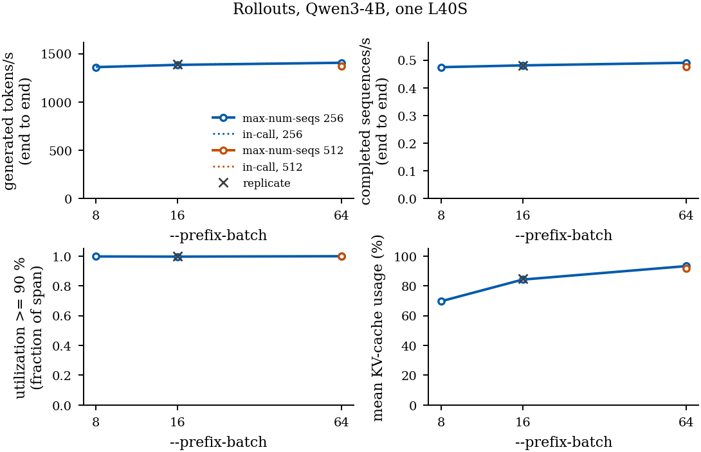
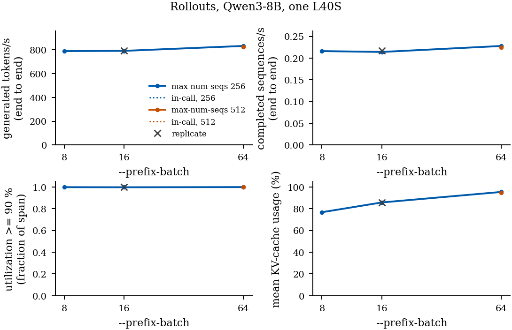

# Throughput settings

## Evaluation

`scripts.evaluate_vllm` starts one vLLM server (`sst/inference/server.py`) with prefix caching enabled and the settings below, then generates through `StudentModel.generate`, which sends each batch to the server as one HTTP request. `sst/inference/pipelined_generation.py` keeps `--pipeline-depth` batches submitted: when the oldest batch returns, the next batch is submitted before the returned one is graded, so the server keeps decoding while the CPU grades. Grading runs in a process pool with a per-item timeout; an item that times out is counted as incorrect.

| Setting | Argument | Value used in the project's evaluation runs |
|---|---|---|
| Concurrent sequences on the server | `--max-num-seqs` | 512 to 1024 |
| Client batch size | equal to `--max-num-seqs` | 512 |
| Submitted batches | `--pipeline-depth` | 2 to 3 |
| Prefix caching | always on | on |
| GPU memory fraction | `--gpu-memory-utilization` | 0.55 (4B) to 0.90 (8B) |
| Tensor parallel devices | `--tensor-parallel-size` | 1 |
| Continuation cap | `--max-new-tokens` | 2,048 to 32,768 |
| Context length | `--max-model-len` | prompt plus cap; 40,960 for a 32,768 cap |

## Rollouts

`scripts.run_step_rollouts` runs vLLM in process with prefix caching. Each call to `generate` carries `--prefix-batch` prefixes, each with one greedy request and one request for `k - 1` sampled continuations, so all continuations of a batch are scheduled together.

| Setting | Argument | Value in the released rollouts |
|---|---|---|
| Continuations per step | `--k` | 16 at refined steps (1 greedy, 15 sampled), 8 elsewhere |
| Continuation cap | `--max-new-tokens` | 4,096 |
| Temperature, top-p, seed | `--temperature`, `--top-p`, `--seed` | not recoverable |
| Prefixes per call | `--prefix-batch` | no project value |
| Concurrent sequences in the engine | `--max-num-seqs` | no project value |
| GPU memory fraction | `--gpu-memory-utilization` | no project value |

### L40S (48 GB), measured

vLLM 0.19.1, one GPU, `--k 16 --max-new-tokens 4096 --max-model-len 24576 --gpu-memory-utilization 0.90`. Each setting ran the same 35 step prefixes (560 continuations).

| Model | `--max-num-seqs` | `--prefix-batch` | Calls | Generated tokens/s | Preemptions | Median running sequences |
|---|---:|---:|---:|---:|---:|---:|
| Qwen3-4B | 256 | 8 | 5 | 1,361 | 154 | 73 |
| Qwen3-4B | 256 | 16 | 3 | 1,384 | 486 | 81 |
| Qwen3-4B | 256 | 64 | 1 | 1,406 | 986 | 85 |
| Qwen3-4B | 512 | 64 | 1 | 1,373 | 1,059 | 87 |
| Qwen3-8B | 256 | 8 | 5 | 790 | 538 | 58 |
| Qwen3-8B | 256 | 16 | 3 | 792 | 1,075 | 62 |
| Qwen3-8B | 256 | 64 | 1 | 833 | 2,445 | 65 |
| Qwen3-8B | 512 | 64 | 1 | 824 | 1,837 | 63 |

`--prefix-batch 64` exceeded the 35 prefixes of the workload, so all of them went in one call; batches larger than 35 were not timed.

GPU utilization was about 100 % in every setting, so tokens/s is the measure that separates them. A repeat of the 256 / 16 setting differed by 4.8 tokens/s (4B) and 3.5 tokens/s (8B); differences smaller than that are not resolved, and that estimate rests on one repeat per model. Fewer sequences ran than `--max-num-seqs` allows; we attribute this to the KV cache filling first, and preemptions occurred in every setting. Raising `--max-num-seqs` to 512 did not raise throughput (4B 1,373, 8B 824). With more prefixes per call, less time was spent with few sequences running.

`python -m analysis.make_throughput_figure` redraws both figures from `docs/throughput_l40s.json`.

### A100 (80 GB), as recorded

The released rollouts were generated on A100 80 GB GPUs with an earlier version of this pipeline: one GPU per shard, 16 to 32 shards per model, 8 traces in flight per server. `--max-num-seqs`, `--gpu-memory-utilization` and `--prefix-batch` were not recorded, and no throughput graph is available.
